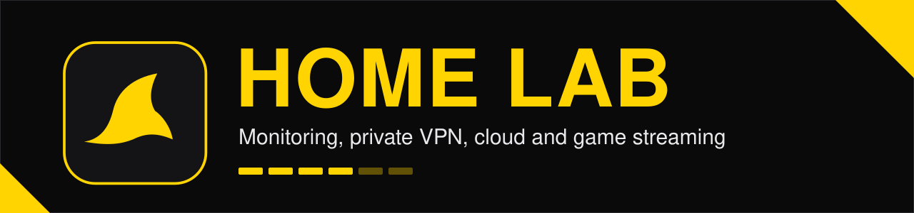
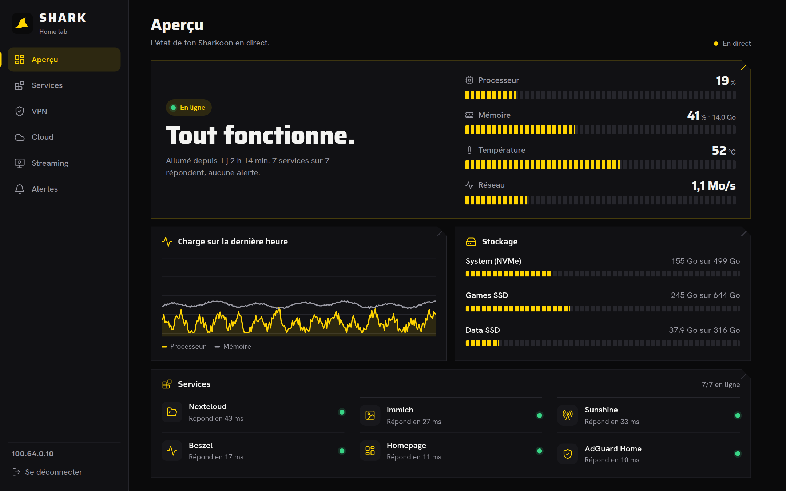
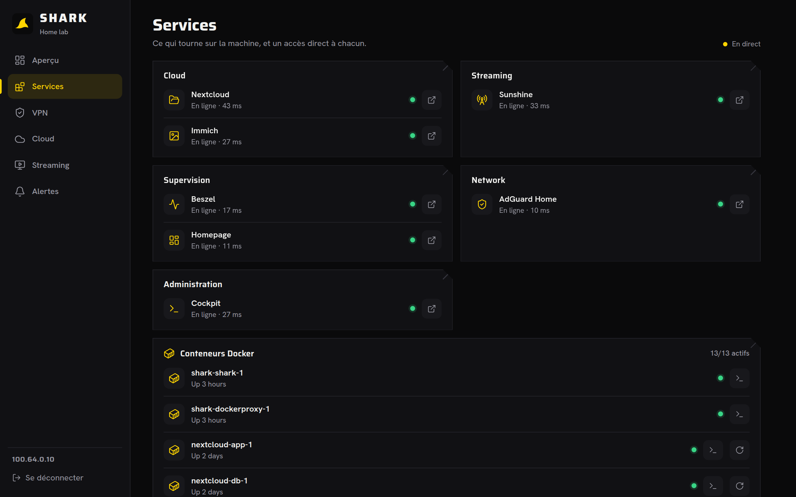
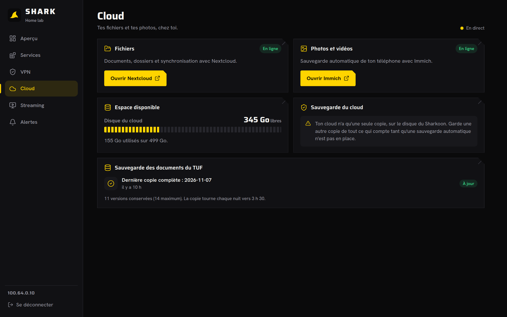
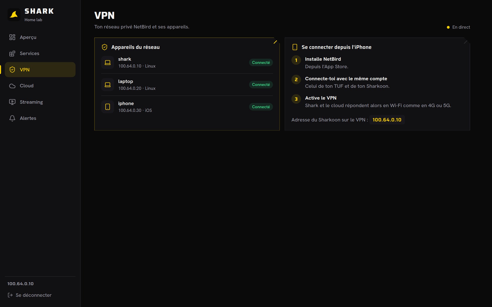
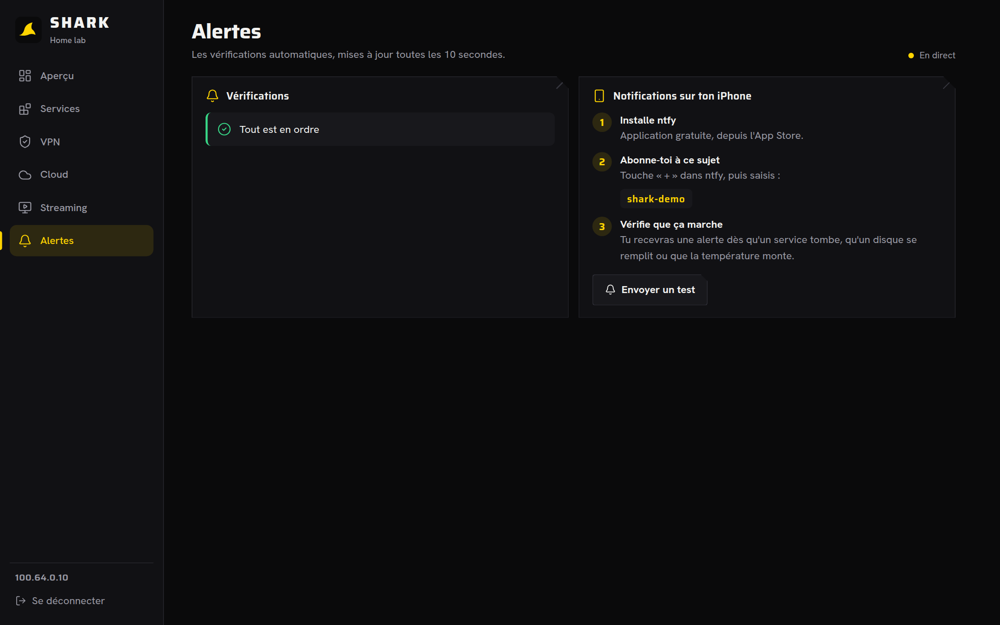
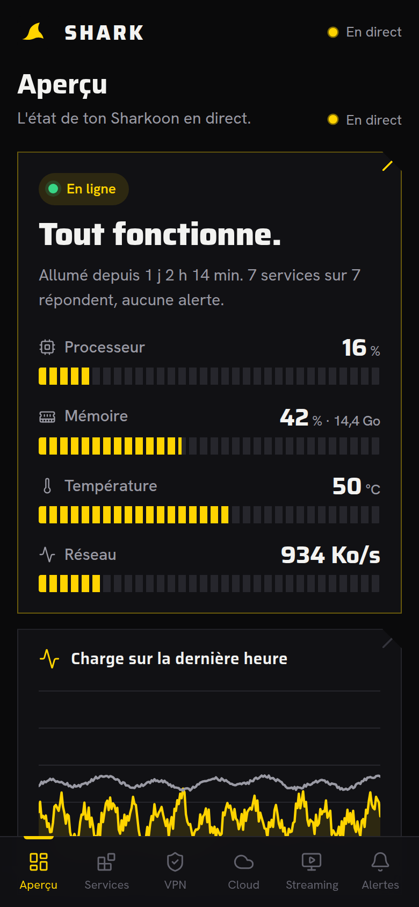
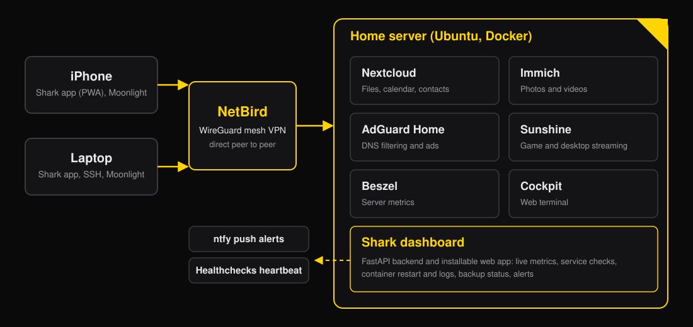

<p align="center">
  
</p>

<p align="center">
  
  
  
  
  
  
  
  
</p>

A self-hosted home lab on a single Linux server, reachable from anywhere through a private VPN, with its own **monitoring and supervision platform**, **Shark**: an installable web app that shows the health of the whole server, restarts containers, reads logs and pushes alerts to a phone.

Everything runs in Docker, nothing is exposed to the internet, and the whole lab costs nothing beyond the hardware.

> The Shark interface is currently in French. Documentation, code and commit messages are in English.

## Shark: the monitoring and supervision platform

<p align="center">
  
</p>

| Services and containers | Cloud and backups |
|---|---|
|  |  |

| VPN peers | Alerts | On the phone |
|---|---|---|
|  |  |  |

What it does:

- **Live overview**: CPU, memory, temperature and network meters, one hour of history, disk usage.
- **Service checks**: an HTTP probe for every service you configure, with response times and direct links.
- **Containers**: the list of Docker containers with one-tap restart and a log viewer, through a restricted socket proxy.
- **Backups**: status of the nightly snapshots of the workstation.
- **Alerts**: automatic checks (full disk, memory, temperature, service or container down) pushed to the phone with [ntfy](https://ntfy.sh).
- **Dead man's switch**: a heartbeat to [Healthchecks.io](https://healthchecks.io), so you are warned even when the whole server is off.
- **Installable**: works as an app on iOS and desktop (PWA), black and yellow design with segmented LED meters.

## What runs in the lab

<p align="center">
  
</p>

| Service | Role |
|---|---|
|  | Mesh VPN built on WireGuard, direct peer to peer, no open port on the router |
|  | Private cloud for files, calendar and contacts |
|  | Private photo and video library with phone backup |
|  | DNS filtering for ads and trackers |
|  | Game and desktop streaming host, used with Moonlight |
|  | Lightweight server metrics hub |
|  | Web terminal and system administration |
|  | Push notifications to the phone |
|  | External watchdog that alerts when the server stops pinging |
|  | Nightly hardlink snapshots of the laptop, resumable over Wi-Fi |

The host is a Ryzen 5 2400G machine with 32 GB of RAM running Ubuntu, managed from a laptop. It is described in [docs/architecture.md](docs/architecture.md).

## Try it without a server

Demo mode serves realistic sample data, so you can explore the dashboard on any machine, without Docker, a VPN or real services:

```bash
python3 -m venv .venv && . .venv/bin/activate
pip install -r requirements.txt
SHARK_DEMO=1 SHARK_CONFIG=config.demo.json SHARK_PASSWORD=demo SHARK_SECRET=local \
  uvicorn app.main:app --port 7071
```

Open `http://localhost:7071` and sign in with the password `demo`. The screenshots above were taken this way.

## Quick start

Requirements: a Linux host with Docker and Docker Compose, plus a VPN or network you trust (Shark serves plain HTTP).

```bash
cp .env.example .env        # set SHARK_PASSWORD and SHARK_SECRET
$EDITOR config.json         # your host IP, services and disks
docker compose up -d --build
```

Open `http://<host-ip>:7070`. On iPhone, use Safari, then Share, then Add to Home Screen.

See [docs/deployment.md](docs/deployment.md) for details and [docs/architecture.md](docs/architecture.md) for how it works.

## Configuration

| Variable | Required | Purpose |
|---|---|---|
| `SHARK_PASSWORD` | yes | Password of the web UI |
| `SHARK_SECRET` | yes | Secret used to sign session cookies |
| `NETBIRD_API_TOKEN` | no | Lists NetBird peers in the VPN page |
| `NTFY_TOPIC` | no | Enables push alerts (use a long random topic, it acts as a password) |
| `HEALTHCHECK_URL` | no | Healthchecks.io ping URL, pinged every minute |
| `BACKUPS_DIR` | no | Host folder with backup snapshots, mounted read-only to show their status |
| `SHARK_DEMO` | no | Set to `1` for sample data (see above) |
| `SHARK_CONFIG` | no | Path to an alternative config file, for example `config.demo.json` |

Services and disks are defined in [`config.json`](config.json).

## Security notes

- Shark is meant to be reachable **only through a VPN** or a trusted LAN. Do not expose port 7070 to the internet.
- Login is a single shared password, signed cookie sessions (HttpOnly, SameSite=Strict) and a rate limit of 8 failed attempts per 5 minutes per IP.
- Docker is reached through `tecnativa/docker-socket-proxy`, which only allows listing and restarting containers.
- The app mounts only a hostname file (for root disk usage) and `/mnt` read-only from the host.

## Project layout

```
app/main.py          FastAPI backend: auth, metrics, health checks, Docker, NetBird, alerts
app/demo.py          Sample data for demo mode
app/static/          Vanilla JS PWA (no build step), Lucide icons, self-hosted fonts
config.json          Services and disks to monitor
config.demo.json     Example configuration used by demo mode
docker-compose.yml   Shark + Docker socket proxy
docs/                Architecture, deployment, roadmap, screenshots and diagrams
```

## Roadmap

See [docs/roadmap.md](docs/roadmap.md).
